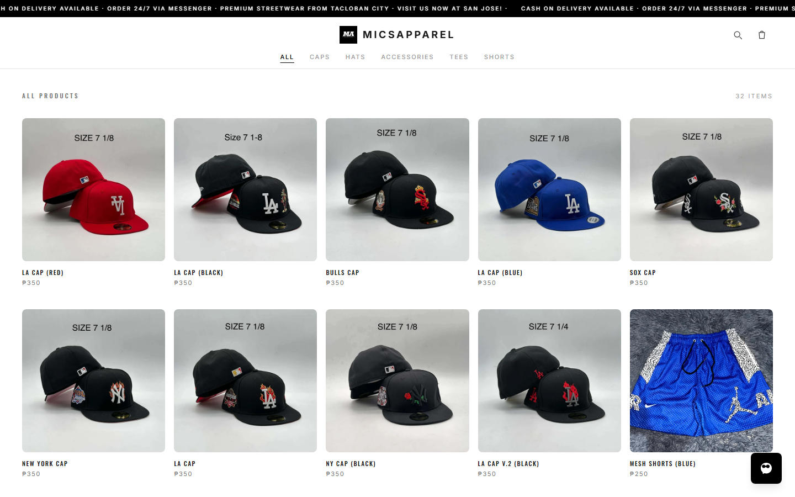

<div align="center">

# Mics Apparel

**Premium streetwear from Tacloban City.**

[**Shop the drop**](https://micsapparel.vercel.app) · [Collections](https://micsapparel.vercel.app/collections) · [Contact](https://micsapparel.vercel.app/contact)

[](https://micsapparel.vercel.app)

<sub>Next.js 16 · React 19 · TypeScript · Tailwind CSS 4 · PostgreSQL (Neon)</sub>
</div>

Mics Apparel is a mobile-first storefront and order desk for a Tacloban streetwear label.
Shoppers browse the current drop, build a cart, and check out with GCash, Maya, bank
transfer, or cash on delivery. Everything the shop sells — products, categories, photos,
reviews, homepage copy, and incoming orders — is managed from a password-protected admin
studio, so the store can be restocked without a deploy.

## Storefront

- **Shop by category** — Caps, Hats, Accessories, Tees and Shorts with instant filtering,
  per-product photo galleries, sizes and stock status.
- **Cart & checkout** — a persistent cart drawer, then a one-page checkout that captures
  delivery details and the preferred payment method (GCash, Maya, bank transfer, or COD
  for select areas).
- **Orders** — every checkout is written to Postgres with its line items, quantities and
  totals, and the customer lands on a branded success page with an order number.
- **Reviews, FAQ and story** — customer photos and quotes, sizing and shipping answers,
  and an about page for the brand.
- **Messenger, everywhere** — a one-tap chat entry point for questions and manual orders.

## Admin studio (`/admin`)

| Area | What it does |
| --- | --- |
| Products | Create, edit, feature and archive items; bulk product import |
| Categories | Rename and reorder the collections shown on the storefront |
| Orders | Review incoming orders, payment method and fulfilment status |
| Reviews | Approve and curate customer reviews |
| Content | Edit homepage copy, hero and announcement text |
| Media | Upload once, reuse product imagery across the catalog |
| Logo | Swap the storefront mark without touching code |

Admin sessions are signed, HTTP-only cookies; the password comes from
`ADMIN_PASSWORD` (see `.env.example`).

## Stack

| Layer | Choice |
| --- | --- |
| Framework | Next.js 16 (App Router, route handlers) |
| UI | React 19, TypeScript, Tailwind CSS 4 |
| Data | PostgreSQL (Neon) via `pg`, JSONB documents, schema auto-created on first connection |
| Media | Uploads stored server-side and served through `/api/media/[id]` |
| SEO | Metadata, Open Graph, sitemap and robots routes |

## Getting started

```bash
git clone https://github.com/Jorayyy/micsapparel.git
cd micsapparel
npm install
cp .env.example .env.local   # set DATABASE_URL and ADMIN_PASSWORD
npm run dev
```

Open http://localhost:3000. The storefront falls back to the seed catalog in `src/data`
until the database has products; visit `/admin` to add real ones.

Importing an older file-backed dataset? `npm run migrate:neon` copies it into Postgres.

## Project layout

```
src/
  app/            storefront routes, /admin studio, /api handlers
  components/     cart drawer, product cards, shop browser, messenger, chrome
  data/           seed business info and catalog
  lib/            database + store, admin auth, cart context, formatting, SEO
```

## Deploy

Import the repo on Vercel and set `DATABASE_URL`, `ADMIN_PASSWORD`,
`ADMIN_SESSION_SECRET`, and `NEXT_PUBLIC_SITE_URL`. There is no separate migration step:
tables are created on first connection, so a fresh database is ready after the first
request.
